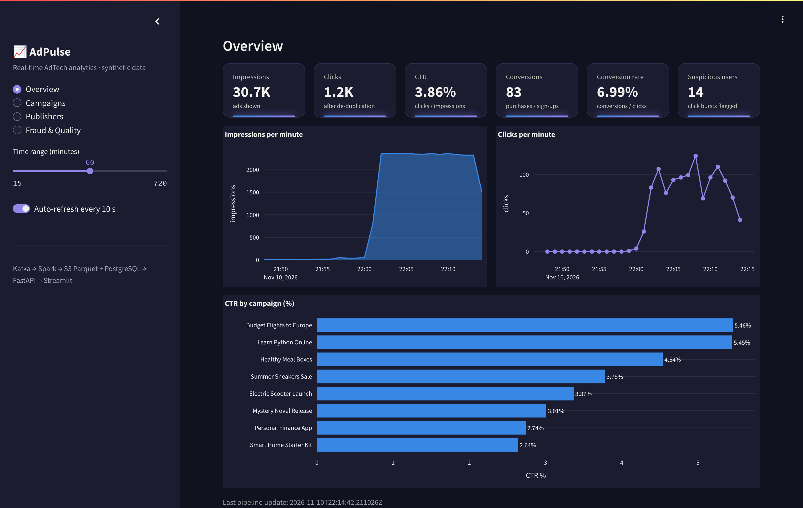
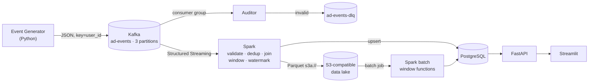

# AdPulse – Real-Time AdTech Analytics Platform

> An end-to-end, **100% free and local** streaming data platform that simulates an ad-tech company:
> synthetic ad events flow through **Kafka**, are processed by **Spark Structured Streaming**, land in an
> **S3-compatible data lake** (Parquet) and **PostgreSQL**, and are served by **FastAPI** to a **Streamlit** dashboard.
> Everything runs with one `docker compose up`.



*Personal learning project built to get hands-on with streaming data engineering. All data is synthetic –
fictional campaigns, publishers and users. Not affiliated with any company.*

---

## What it does

| Capability | How |
|---|---|
| Simulates ad traffic | Python generator: impressions → clicks → conversions, with realistic CTR/CVR per campaign |
| Injects real-world mess | duplicates, malformed/invalid events, late events (up to 14 min), bot click bursts |
| Streams events | Kafka (KRaft) topic `ad-events`, 3 partitions, keyed by `user_id`; dead-letter topic `ad-events-dlq` |
| Validates & routes bad data | Python consumer group (manual offset commits) + identical rules in Spark |
| Real-time processing | Spark: schema parsing, validation, broadcast join, **watermark**, **dedup**, 1-min **event-time windows** |
| Fraud detection | ≥ 8 clicks from the same user+IP on one campaign within 1 minute → flagged |
| Data lake | Parquet in an S3 bucket (SeaweedFS locally – same code works on AWS S3) |
| Serving layer | PostgreSQL facts + views, idempotent upserts from Spark |
| Batch analytics | Spark batch job ranks publishers per campaign with `RANK() OVER (PARTITION BY …)` |
| API | FastAPI with typed responses and Swagger docs at `/docs` |
| Dashboard | Streamlit: KPIs, CTR, conversion rate, campaign/publisher performance, fraud & data quality |

## Architecture



More detail (containers, version matrix, AWS mapping): [docs/ARCHITECTURE.md](docs/ARCHITECTURE.md)

## Tech stack (all free & open source)

| Layer | Technology | Version |
|---|---|---|
| Messaging | Apache Kafka (KRaft, no ZooKeeper) | 3.9.1 |
| Processing | Apache Spark / PySpark Structured Streaming | 3.5.7 |
| Object storage | SeaweedFS (S3 API) – replaces MinIO, whose free community images were discontinued in 2025 | 4.53 |
| Database | PostgreSQL | 16 |
| API | FastAPI + Uvicorn + Pydantic | 0.115 |
| Dashboard | Streamlit + Plotly | 1.40 |
| Kafka client | confluent-kafka | 2.6.1 |
| Containers | Docker Engine / Docker Compose | – |
| Tests | pytest (unit, PySpark, integration) | 8.3 |

## Quick start (full system, local)

Requirements: Docker (Docker Desktop on Windows/macOS, Docker Engine on Linux), ~8 GB RAM free, ~6 GB disk.

```bash
git clone <this-repo-url> AdPulse && cd AdPulse
cp .env.example .env            # then change the passwords in .env
docker compose up -d --build    # first build downloads ~2 GB, takes 5-10 min
docker compose ps               # wait until services are healthy / running
```

After ~2 minutes data appears:

| What | Where |
|---|---|
| Dashboard | http://localhost:8501 |
| API docs (Swagger) | http://localhost:8000/docs |
| Spark UI | http://localhost:4040 |
| PostgreSQL | `localhost:5432` (credentials from your `.env`) |
| S3 API | http://localhost:8333 |
| Kafka (from host tools) | `localhost:9094` |

```bash
docker compose run --rm spark-batch          # batch report -> publisher rankings
docker compose down                          # stop (keeps data)
docker compose down -v                       # stop and delete all data
```

Step-by-step guide with expected outputs and troubleshooting (Hebrew): [RUN_PROJECT_HE.md](RUN_PROJECT_HE.md)

## Dashboard demo mode (no Docker)

The dashboard can also run from a synthetic snapshot exported from a real run of the pipeline –
this is what a free public demo uses, since free hosts cannot run Kafka and Spark.

```bash
pip install -r requirements.txt
streamlit run streamlit_app.py
```

## Tests

```bash
pip install -r requirements/dev.txt
pytest tests/unit -q                                   # 59 unit tests, no Docker needed
docker compose run --rm --no-deps spark-streaming \
  python3 -m pytest tests/spark -q -p no:cacheprovider # 8 PySpark tests (incl. watermark streaming test)
pytest -m integration tests/integration -v             # 7 end-to-end tests vs. the running stack
```

## Project structure

```
AdPulse/
├── docker-compose.yml          # 11 services, health checks, volumes, one network
├── docker/                     # app + Spark Dockerfiles, SeaweedFS entrypoint
├── src/adpulse/
│   ├── config.py               # settings from environment variables
│   ├── models.py, metrics.py, validation.py
│   ├── generator/              # synthetic catalog + event factory + runner
│   ├── kafka_io/               # topic admin, producer, consumer-group auditor (DLQ)
│   ├── storage/                # S3 helper (boto3), PostgreSQL repository
│   ├── api/                    # FastAPI app + response schemas
│   └── dashboard/              # Streamlit app, API client, demo data source
├── spark_jobs/
│   ├── streaming_job.py        # 6 streaming queries
│   ├── batch_report_job.py     # batch report with window functions
│   └── adpulse_spark/          # schemas, transformations, sinks, session
├── sql/init/                   # schema, views, seed data
├── tests/{unit,spark,integration}
├── demo_data/                  # synthetic snapshot + sample events
├── docs/                       # architecture, screenshots
└── *_HE.md, ADPULSE_PRESENTATION_HE.pptx   # Hebrew learning material
```

## Business rules

- **CTR** = clicks / impressions × 100 · **Conversion rate** = conversions / clicks × 100
- **Validation**: required fields, known event type, parseable time, not > 5 min in the future, no negative money,
  known campaign/publisher → otherwise quarantined (Parquet) and counted
- **Deduplication** by `event_id` within the watermark (network retries must not inflate billing)
- **Late events**: accepted up to 10 minutes late (watermark) and merged into the right window; older ones dropped
- **Fraud**: ≥ 8 clicks / user+IP / campaign / minute

## Engineering notes

- No secrets in code or Git: everything comes from `.env` (ignored); `.env.example` has placeholders only.
- Idempotent sinks: window aggregates are upserted with their full value, so a replayed micro-batch is harmless.
- At-least-once delivery end to end; exactly-once would need transactional sinks (documented trade-off).
- Single-broker Kafka, Spark `local[*]` – intentionally small for a laptop; the same code scales out on a cluster.

## Learning material (Hebrew)

| File | Content |
|---|---|
| [LEARNING_GUIDE_HE.md](LEARNING_GUIDE_HE.md) | Every concept and every important file explained simply |
| [RUN_PROJECT_HE.md](RUN_PROJECT_HE.md) | Install, run, verify, troubleshoot |
| [INTERVIEW_PREPARATION_HE.md](INTERVIEW_PREPARATION_HE.md) | Pitches, 30+ Q&A, comparisons, design questions |
| [GIT_GUIDE_HE.md](GIT_GUIDE_HE.md) | Git & GitHub backup workflow |
| [PORTFOLIO_DEPLOYMENT_HE.md](PORTFOLIO_DEPLOYMENT_HE.md) | Free public demo options and what visitors can see |
| [ADPULSE_PRESENTATION_HE.pptx](ADPULSE_PRESENTATION_HE.pptx) | 20-slide presentation with speaker notes |

## License

MIT – see [LICENSE](LICENSE).
