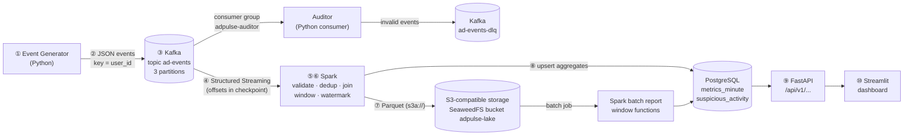

# AdPulse – Architecture

## Data flow (10 steps)



ASCII version (for terminals):

```
 ┌───────────┐   JSON    ┌──────────────────────┐            ┌───────────────────────────┐
 │ Generator │ ────────▶ │ Kafka  ad-events      │ ─────────▶ │ Spark Structured Streaming │
 │ (Python)  │ key=user  │ P0 | P1 | P2          │            │ parse→validate→dedup→join  │
 └───────────┘           └──────────┬───────────┘            │ →window+watermark→aggregate│
                                    │                         └──────┬──────────────┬──────┘
                          ┌─────────▼─────────┐                Parquet│              │upsert
                          │ Auditor consumer  │──▶ ad-events-dlq      ▼              ▼
                          │ (consumer group)  │            ┌────────────────┐  ┌──────────────┐
                          └───────────────────┘            │ S3 (SeaweedFS) │  │ PostgreSQL   │
                                                           │ events/ invalid│  │ metrics, fraud│
                                                           └───────┬────────┘  └──────┬───────┘
                                                      batch report │                  │
                                                                   └──────▶───────────┤
                                                                               ┌──────▼──────┐
                                                                               │ FastAPI     │──▶ Streamlit
                                                                               └─────────────┘
```

## Containers (docker compose)

| Service | Image | Port on your computer | Role |
|---|---|---|---|
| `kafka` | `apache/kafka:3.9.1` (KRaft, no ZooKeeper) | 9094 | Message broker |
| `kafka-init` | app image | – | Creates topics, then exits |
| `postgres` | `postgres:16.15-alpine` | 5432 | Analytics database |
| `seaweedfs` | `chrislusf/seaweedfs:4.53` | 8333 (S3 API) | Local S3-compatible object storage |
| `storage-init` | app image | – | Creates the S3 bucket, then exits |
| `generator` | app image | – | Produces synthetic events |
| `auditor` | app image | – | Python consumer group, DLQ routing |
| `spark-streaming` | spark image (`apache/spark:3.5.7` + jars) | 4040 (Spark UI) | Real-time processing |
| `spark-batch` | spark image (profile `batch`) | – | Batch report with window functions |
| `api` | app image | 8000 | FastAPI REST |
| `dashboard` | app image | 8501 | Streamlit UI |

## Version compatibility (checked)

| Component | Version | Why compatible |
|---|---|---|
| Spark | 3.5.7 (Scala 2.12, Java 17, Python 3.10 in image) | Spark 3.5 supports Java 8/11/17 and Python 3.8+ |
| spark-sql-kafka-0-10 | 3.5.7 | must equal the Spark version |
| kafka-clients (inside Spark) | 3.4.1 | the version Spark 3.5 is built against; talks to any broker ≥ 0.10 |
| Kafka broker | 3.9.1 | backward compatible with older clients |
| hadoop-aws | 3.3.4 | must equal Spark's bundled Hadoop (3.3.4) |
| aws-java-sdk-bundle | 1.12.262 | the version hadoop-aws 3.3.4 was built with |
| PostgreSQL JDBC | 42.7.4 | Java 8+ |
| Python services | 3.11 | confluent-kafka 2.6.1, FastAPI 0.115, Streamlit 1.40 all support 3.11 |

## Why SeaweedFS instead of MinIO

MinIO Community Edition stopped publishing free Docker images and binaries in
October 2025 and its repository was archived in 2026 (source-only, no updates).
Using an unmaintained storage server is not a good engineering choice, so
AdPulse uses **SeaweedFS** (Apache-2.0 license, actively maintained, free,
S3-compatible API). The code talks plain S3 API (`boto3`, `s3a://`), so it works
the same with MinIO, SeaweedFS, or real AWS S3 – only the endpoint URL and
credentials change.

## How this maps to AWS (theory only – nothing is deployed)

| Local | AWS equivalent |
|---|---|
| SeaweedFS bucket `adpulse-lake` | Amazon S3 bucket |
| `S3_ACCESS_KEY`/`S3_SECRET_KEY` in `.env` | IAM role attached to the compute (no static keys) |
| Kafka container | Amazon MSK |
| Spark container | EMR / EMR Serverless / AWS Glue |
| PostgreSQL container | Amazon RDS for PostgreSQL |
| FastAPI + Streamlit containers | ECS Fargate / App Runner |

See `LEARNING_GUIDE_HE.md` for a full explanation.
